# 🚀 SmartPrep-AI CI/CD Pipeline & Branching Strategy

This document outlines the Continuous Integration (CI) and Continuous Deployment (CD) architecture for **SmartPrep-AI**, powered by **GitHub Actions**.

---

## 🌳 Git Branching Model

To ensure code stability, quality, and seamless releases, SmartPrep-AI enforces a strict two-stage branch integration workflow:

```
┌─────────────────────────────────┐
│ Feature / Bugfix / Task Branch  │ (e.g., feature/login, fix/chat-scroll)
└───────────────┬─────────────────┘
                │
                ▼ Pull Request (CI runs automated checks)
┌─────────────────────────────────┐
│           dev branch            │ (Integration & Staging Environment)
└───────────────┬─────────────────┘
                │
                ▼ Pull Request (Strictly ONLY allowed from 'dev')
┌─────────────────────────────────┐
│          main branch            │ (Stable Production Environment)
└─────────────────────────────────┘
```

### Core Rules:
1. **Feature & Bugfix Work:**
   - Always branch off `dev`:
     ```bash
     git checkout dev
     git pull origin dev
     git checkout -b feature/your-feature-name
     ```
   - All Pull Requests must target **`dev`**.
2. **Integration & Testing on `dev`:**
   - Once a feature PR is approved and passes CI, it is merged into `dev`.
   - The `dev` branch represents the latest integrated code deployed to the development/staging environment.
3. **Production Releases to `main`:**
   - **Direct PRs to `main` from feature or personal branches are strictly blocked** by GitHub Actions (`branch-rules.yml` and `ci.yml`).
   - Production releases are performed by opening a Pull Request from **`dev`** into **`main`**.
   - Merging `dev` into `main` triggers production validation and automated deployment.

---

## ⚙️ GitHub Actions Workflows

The CI/CD pipeline consists of three modular workflows located in `.github/workflows/`:

| Workflow File | Trigger | Responsibility |
| :--- | :--- | :--- |
| **`branch-rules.yml`** | PR opened / edited / synced (`main`, `dev`) | Enforces branch hierarchy policy. Blocks any PR targeting `main` unless its head branch is `dev`. |
| **`ci.yml`** | PR & Push (`dev`, `main`) | Automated testing matrix: Node.js 20 typecheck & Next.js build, Python 3.11 lint & pytest, and Docker compose validation. |
| **`cd-dev.yml`** | Push to `dev` or Manual dispatch | Triggers deployment hooks for Development / Staging environment on Render and Vercel. |
| **`cd-prod.yml`** | Push to `main` or Manual dispatch | Triggers deployment hooks for Production environment on Render and Vercel. |

---

## 🔍 CI Pipeline Breakdown (`ci.yml`)

When a PR is created or updated, GitHub Actions executes four jobs in parallel:

```mermaid
flowchart TD
    Start([Push / Pull Request]) --> Policy[1. Branch Policy Check]
    Policy --> Client[2. Client CI - Next.js]
    Policy --> Server[3. Server CI - FastAPI]
    Policy --> Docker[4. Docker Validation]

    subgraph Client [Client CI]
        NodeSetup[Setup Node.js 20 & Cache]
        NpmInstall[npm ci]
        TypeCheck[TypeScript Typecheck: npm run typecheck]
        NextBuild[Production Build: npm run build]
        NodeSetup --> NpmInstall --> TypeCheck --> NextBuild
    end

    subgraph Server [Server CI]
        PySetup[Setup Python 3.11 & Cache]
        SysDeps[Install poppler, tesseract, ffmpeg]
        PipInstall[pip install dependencies]
        CompileCheck[python -m compileall server]
        Lint[flake8 syntax check]
        Pytest[pytest tests/]
        PySetup --> SysDeps --> PipInstall --> CompileCheck --> Lint --> Pytest
    end

    subgraph Docker [Docker CI]
        ComposeConfig[Validate docker-compose.yml]
        DockerBuild[Test Build Server Dockerfile]
        ComposeConfig --> DockerBuild
    end
```



---

## 🚢 CD Pipeline Breakdown (`cd.yml`)

The CD workflow deploys code automatically when changes land on `dev` or `main`:

- **Push to `dev`** $\rightarrow$ Triggers **Development / Staging** deployment:
  - Invokes `RENDER_DEV_DEPLOY_HOOK_URL` (if configured)
  - Invokes `VERCEL_DEV_DEPLOY_HOOK_URL` (or relies on Vercel preview branch deployment)
- **Push to `main`** $\rightarrow$ Triggers **Production** deployment:
  - Invokes `RENDER_PROD_DEPLOY_HOOK_URL` (if configured)
  - Invokes `VERCEL_PROD_DEPLOY_HOOK_URL` (or Vercel automatic git production deployment)

---

## 🛡️ Recommended GitHub Branch Protection Setup

To enforce this workflow at the repository settings level in GitHub:

1. Open your repository on GitHub: **Settings $\rightarrow$ Branches $\rightarrow$ Add branch ruleset (or Branch protection rule)**.
2. **Rule for `main`:**
   - **Branch name pattern:** `main`
   - Check **Require a pull request before merging**
   - Check **Require approvals** (recommended: 1 approval)
   - Check **Require status checks to pass before merging**:
     - `Validate Branch Merge Rules` (`branch-rules.yml`)
     - `Client Checks (Typecheck & Build)` (`ci.yml`)
     - `Server Checks (Lint & Test)` (`ci.yml`)
     - `Docker Configuration Validation` (`ci.yml`)
   - Check **Require branches to be up to date before merging**
   - Check **Do not allow bypassing the above settings**
3. **Rule for `dev`:**
   - **Branch name pattern:** `dev`
   - Check **Require a pull request before merging**
   - Check **Require status checks to pass before merging** (`Client Checks`, `Server Checks`, `Docker Configuration Validation`)
   - Check **Require branches to be up to date before merging**

---

## 🔐 GitHub Repository Secrets Configuration

To enable automated CD notifications or deploy triggers, add the following optional secrets under **Settings $\rightarrow$ Secrets and variables $\rightarrow$ Actions**:

| Secret Name | Description | Source |
| :--- | :--- | :--- |
| `RENDER_PROD_DEPLOY_HOOK_URL` | Production Render Webhook | Render Dashboard $\rightarrow$ Web Service $\rightarrow$ Settings $\rightarrow$ Deploy Hook |
| `RENDER_DEV_DEPLOY_HOOK_URL` | Dev/Staging Render Webhook | Staging Web Service Deploy Hook on Render |
| `VERCEL_PROD_DEPLOY_HOOK_URL` | Production Vercel Deploy Hook | Vercel Project $\rightarrow$ Settings $\rightarrow$ Git $\rightarrow$ Deploy Hooks |
| `VERCEL_DEV_DEPLOY_HOOK_URL` | Dev Vercel Deploy Hook | Vercel Project $\rightarrow$ Settings $\rightarrow$ Git $\rightarrow$ Deploy Hooks |

---

## 💻 Developer Local Pre-Flight Checklist

Before opening a Pull Request, run these checks locally to ensure CI will pass on the first attempt:

### 1. Frontend Check (Client)
```bash
cd client
npm run typecheck
npm run build
```

### 2. Backend Check (Server)
```bash
cd server
python -m compileall .
pytest tests/ -v
```

### 3. Docker Check
```bash
docker compose config
```
